# 基于Web的电子产品销售系统设计与实现--论文

> 🎓 **计算机毕业设计 · 基于Web的电子产品销售系统设计与实现--论文**
>
> 本仓库只放**项目介绍 + 运行截图**（截图是站点带水印的原图，存在仓库 `images/` 里）。
>
> 👉 **完整可运行源码 / 数据库脚本 / 部署文档：[点我获取](https://geekcode.top/archives/%E5%9F%BA%E4%BA%8EWeb%E7%9A%84%E7%94%B5%E5%AD%90%E4%BA%A7%E5%93%81%E9%94%80%E5%94%AE%E7%B3%BB%E7%BB%9F%E8%AE%BE%E8%AE%A1%E4%B8%8E%E5%AE%9E%E7%8E%B0-%E8%AE%BA%E6%96%87?utm_source=github)**
>
> 💬 咨询微信：**ir9372**　|　🌐 更多项目：[极客代码 geekcode.top](https://geekcode.top/?utm_source=github)
>
> 📌 项目详情页：<https://geekcode.top/archives/%E5%9F%BA%E4%BA%8EWeb%E7%9A%84%E7%94%B5%E5%AD%90%E4%BA%A7%E5%93%81%E9%94%80%E5%94%AE%E7%B3%BB%E7%BB%9F%E8%AE%BE%E8%AE%A1%E4%B8%8E%E5%AE%9E%E7%8E%B0-%E8%AE%BA%E6%96%87?utm_source=github>

<table><td width="230" align="center"> <b>扫码加微信 ir9372</b></td><td valign="middle">📦 源码 = 项目介绍 + 全部运行截图 + 数据库 + 部署文档 👉 点上方任意截图，直接跳到 <b>极客代码 geekcode.top</b> 详情页</td></table>

---

<h1>基于Web的电子产品销售系统设计与实现--论文</h1>
<h2>项目概述</h2>

本项目旨在设计并实现一个基于Web的电子产品销售系统，解决传统电子产品零售中信息展示分散、用户交互效率低及管理维护困难等问题。系统采用前后端分离架构，核心功能涵盖电子产品浏览与分类管理、在线通知公告发布、用户留言互动及后台综合数据管理。适用人群包括普通消费者（前台用户）和系统管理员（后台运营人员）。技术架构上，后端基于Spring Boot框架构建RESTful API服务，使用MyBatis-Plus进行持久层操作，集成Apache Shiro实现安全权限控制；前端采用Vue框架开发，提供响应式用户界面。该系统通过标准化的数据管理和友好的交互体验，实现了电子产品销售业务的数字化闭环，提升了商家运营效率与用户购物体验。

<h2>技术架构</h2>
<h3>总体架构</h3>

系统采用经典的前后端分离模式。前端负责页面渲染与用户交互，通过HTTP协议向后端发送请求；后端负责业务逻辑处理、数据校验及数据库交互，返回JSON格式数据。

<a href="https://geekcode.top/archives/%E5%9F%BA%E4%BA%8EWeb%E7%9A%84%E7%94%B5%E5%AD%90%E4%BA%A7%E5%93%81%E9%94%80%E5%94%AE%E7%B3%BB%E7%BB%9F%E8%AE%BE%E8%AE%A1%E4%B8%8E%E5%AE%9E%E7%8E%B0-%E8%AE%BA%E6%96%87?utm_source=github" title="查看完整源码">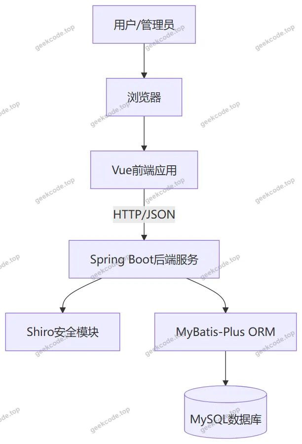</a>

<h3>核心技术选型</h3>
<ol>
<li><strong>后端框架</strong>：选用 Spring Boot 作为基础框架，利用其自动配置特性简化部署流程，集成 <code>spring-boot-starter-web</code> 提供Web服务能力。</li>
<li><strong>持久层框架</strong>：采用 MyBatis-Plus (<code>mybatis-plus</code>) 增强 MyBatis 的功能，通过通用Mapper减少单表CRUD代码量，提高开发效率；底层依赖 <code>mysql-connector-java</code> 连接 MySQL 数据库。</li>
<li><strong>安全框架</strong>：集成 Apache Shiro (<code>shiro-spring</code>) 进行身份认证与授权管理，保障系统接口安全性及用户隐私数据保护。</li>
<li><strong>数据处理</strong>：使用 <code>commons-lang3</code> 进行字符串及对象工具类支持，<code>validation-api</code> 用于参数合法性校验，<code>protobuf-java</code> 可能用于特定高性能数据传输场景。</li>
<li><strong>前端技术</strong>：基于 Vue.js 构建单页应用（SPA），结合 Element UI 等组件库实现后台管理系统界面，确保良好的用户体验与兼容性。</li>
</ol>
<h3>数据库设计要点</h3>

数据库主要存储用户信息、电子产品详情、产品类别、订单记录、评论留言、通知公告及系统配置等数据。设计遵循第三范式，通过外键关联或逻辑关联保证数据一致性。例如，<code>Dianzichanpin</code>（电子产品）表通过 <code>Chanpinleibie</code>（产品类别）ID进行归类，<code>Discussdianzichanpin</code>（评论）表关联具体商品与用户，形成完整的数据链路。

<h2>功能模块</h2>
<h3>前台用户端功能</h3>

前台面向普通消费者，提供便捷的浏览与交互入口。

<ol>
<li><strong>首页展示</strong>：呈现系统概览、推荐产品及最新公告，引导用户快速进入核心功能区。</li>
<li><strong>电子产品浏览</strong>：</li>
</ol>
<ul>
<li><strong>列表查看</strong>：分页展示所有在售电子产品，支持按名称、价格等条件筛选。</li>
<li><strong>详情查看</strong>：展示产品图片、参数、库存及价格信息。</li>
<li><strong>分类检索</strong>：通过“产品类别”导航栏，按不同品类（如手机、电脑等）查看对应产品。</li>
</ul>
<ol start="3">
<li><strong>互动交流</strong>：</li>
</ol>
<ul>
<li><strong>留言板</strong>：用户可提交咨询或建议，查看历史留言列表。</li>
<li><strong>在线客服</strong>：提供即时通讯功能，方便用户与销售方沟通。</li>
<li><strong>评论功能</strong>：用户对已购买或浏览的产品发表评价，形成口碑数据。</li>
</ul>
<ol start="4">
<li><strong>资讯获取</strong>：</li>
</ol>
<ul>
<li><strong>通知公告</strong>：展示平台发布的最新新闻、促销活动或政策调整信息。</li>
<li><strong>关于我们/系统简介</strong>：介绍平台背景、联系方式及服务宗旨。</li>
</ul>
<ol start="5">
<li><strong>个人中心</strong>：虽然菜单未详细列出，但根据路由 <code>/yonghu</code> 及截图“前台-个人中心”，用户可查看个人信息、收藏列表（截图提及“前台-收藏列表”）及可能的订单状态（虽无独立前台订单路由，但后台有订单管理，通常前台需配合展示）。<em>注：根据现有源码Controller列表，存在 <code>AddressController</code> 和 <code>CartController</code>，暗示系统具备购物车与地址管理能力，尽管前台路由列表中未显式标出，但在实际业务流中应包含这些基础电商功能入口。</em></li>
</ol>
<h3>后台管理端功能</h3>

后台面向管理员，提供全面的数据管理与系统配置能力。

<ol>
<li><strong>登录与安全</strong>：管理员通过账号密码登录，受 Shiro 权限体系保护。</li>
<li><strong>内容管理</strong>：</li>
</ol>
<ul>
<li><strong>通知公告 (<code>/news</code>)</strong>：增删改查新闻文章，设置发布时间与状态。</li>
<li><strong>关于我们 (<code>/aboutus</code>)</strong>：编辑平台介绍文本及图片。</li>
<li><strong>系统简介 (<code>/systemintro</code>)</strong>：维护系统整体描述信息。</li>
<li><strong>配置文件 (<code>/config</code>)</strong>：管理系统全局参数，如网站标题、Logo、联系电话等。</li>
</ul>
<ol start="3">
<li><strong>商品管理</strong>：</li>
</ol>
<ul>
<li><strong>电子产品 (<code>/dianzichanpin</code>)</strong>：上架新产品，修改价格、库存、图片，下架商品。</li>
<li><strong>产品类别 (<code>/chanpinleibie</code>)</strong>：定义和维护产品分类树结构。</li>
<li><strong>电子产品评论 (<code>/discussdianzichanpin</code>)</strong>：审核用户评论，删除违规或不实言论。</li>
</ul>
<ol start="4">
<li><strong>用户与互动管理</strong>：</li>
</ol>
<ul>
<li><strong>用户管理 (<code>/yonghu</code>)</strong>：查看注册用户列表，重置密码，禁用异常账号。</li>
<li><strong>留言板管理 (<code>/messages</code>)</strong>：回复用户留言，标记已处理或未处理状态。</li>
<li><strong>在线客服 (<code>/chat</code>)</strong>：监控和管理实时聊天会话记录。</li>
</ul>
<ol start="5">
<li><strong>订单管理 (<code>/orders/:status</code>)</strong>：查看所有订单状态（待付款、已完成等），执行发货、退款等操作。</li>
</ol>
<h2>用户角色与权限</h2>

系统主要涉及两类角色，权限划分清晰，确保数据安全与操作规范。

<h3>1. 普通用户 (Customer)</h3>
<ul>
<li><strong>权限范围</strong>：仅限访问前台公开资源及个人私有数据。</li>
<li><strong>具体权限</strong>：</li>
<li>浏览首页、产品列表、详情页及分类信息。</li>
<li>阅读通知公告、系统简介及关于我们。</li>
<li>在留言板发布留言、查看公开留言。</li>
<li>对电子产品发表评论。</li>
<li>使用在线客服进行咨询。</li>
<li>管理个人收藏、收货地址及购物车（基于 <code>AddressController</code>, <code>CartController</code> 推断）。</li>
<li>查看个人订单状态。</li>
<li><strong>限制</strong>：无法访问任何后台管理接口，无法修改他人数据，无法执行删除、审核等管理操作。</li>
</ul>
<h3>2. 系统管理员 (Admin)</h3>
<ul>
<li><strong>权限范围</strong>：拥有后台全部功能的操作权限，负责系统运营与维护。</li>
<li><strong>具体权限</strong>：</li>
<li><strong>数据CRUD</strong>：对电子产品、类别、新闻、留言、评论、用户信息等所有业务数据进行新增、修改、删除和查询。</li>
<li><strong>业务处理</strong>：审核评论内容，回复用户留言，处理订单流程（发货、关闭等）。</li>
<li><strong>系统配置</strong>：修改网站基本信息、上传Logo、配置系统参数。</li>
<li><strong>用户管理</strong>：查看用户列表，对用户账号进行状态管控（如封禁）。</li>
<li><strong>限制</strong>：通常不直接参与前台购物行为，专注于管理视角。</li>
</ul>
<h2>项目特色与创新点</h2>
<ol>
<li><strong>完善的电商业务闭环</strong>：不同于简单的信息展示系统，本项目集成了从产品展示、分类检索、用户互动（评论、留言、客服）到后台订单管理及内容审核的全流程功能，具备实际商业落地价值。</li>
<li><strong>高效的安全与权限控制</strong>：引入 Apache Shiro 框架，实现了细粒度的权限控制与身份认证，有效防止越权访问和数据泄露，保障了用户隐私及系统数据安全。</li>
<li><strong>灵活的内容管理体系</strong>：通过独立的“通知公告”、“系统简介”、“配置文件”等模块，管理员可以动态更新前端展示内容而无需重新部署代码，提高了系统的可维护性和运营灵活性。</li>
<li><strong>增强的交互体验</strong>：集成在线客服与留言板功能，打破了传统静态网站的单向传播局限，建立了买卖双方的双向沟通渠道，有助于提升用户粘性和满意度。</li>
<li><strong>标准化开发架构</strong>：采用 Spring Boot + MyBatis-Plus + Vue 的主流技术栈，代码结构清晰，分层明确，易于扩展和维护，符合现代企业级应用的开发规范。</li>
</ol>
<h2>部署环境</h2>

为确保系统正常运行，需准备以下软硬件环境：

<h3>硬件环境</h3>
<ul>
<li><strong>服务器</strong>：CPU 2核及以上，内存 4GB 及以上，硬盘 50GB 及以上可用空间。</li>
<li><strong>客户端</strong>：主流PC或移动设备，支持HTML5标准的浏览器。</li>
</ul>
<h3>软件环境</h3>
<ol>
<li><strong>操作系统</strong>：Windows 10/11, Linux (CentOS 7+/Ubuntu 18.04+), 或 macOS。</li>
<li><strong>JDK</strong>：Java Development Kit 1.8 或更高版本（推荐 JDK 1.8，兼容性好）。</li>
<li><strong>数据库</strong>：MySQL 5.7 或 MySQL 8.0。需安装 MySQL Server 并创建相应数据库实例。</li>
<li><strong>Node.js</strong>：用于前端 Vue 项目的编译与打包，建议版本 v12.x 或 v14.x 以上。</li>
<li><strong>Maven</strong>：3.6 或以上版本，用于后端 Java 项目的依赖管理与构建。</li>
<li><strong>Web服务器</strong>：Nginx 或 Apache HTTP Server，用于托管前端静态资源及反向代理后端API（生产环境推荐）。开发环境可直接使用 Spring Boot 内置 Tomcat。</li>
<li><strong>浏览器</strong>：Chrome, Firefox, Edge, Safari 等现代浏览器的最新版本。</li>
</ol>
<h3>部署步骤简述</h3>
<ol>
<li>安装 JDK, MySQL, Node.js, Maven。</li>
<li>导入 SQL 脚本至 MySQL 数据库，创建表结构与初始数据。</li>
<li>修改后端 <code>application.yml</code> 中的数据库连接配置（URL, Username, Password）。</li>
<li>使用 Maven 编译打包后端项目，生成 jar 包并运行。</li>
<li>进入前端项目目录，执行 <code>npm install</code> 安装依赖，随后执行 <code>npm run build</code> 生成静态文件。</li>
<li>将前端生成的 <code>dist</code> 目录部署至 Nginx 或 Web 服务器，配置反向代理指向后端服务端口。</li>
</ol>
<h2>五、技术特性</h2>
<ul>
<li>前后端集成部署，前端资源打包至后端 static 目录</li>
<li>使用 MyBatis-Plus 简化数据访问层开发</li>
<li>集成 Shiro 权限框架实现角色权限控制</li>
</ul>
<h2>六、功能模块截图</h2>
<h3>前台用户端</h3>
<h4>前台-产品类别列表</h4>

<a href="https://geekcode.top/archives/%E5%9F%BA%E4%BA%8EWeb%E7%9A%84%E7%94%B5%E5%AD%90%E4%BA%A7%E5%93%81%E9%94%80%E5%94%AE%E7%B3%BB%E7%BB%9F%E8%AE%BE%E8%AE%A1%E4%B8%8E%E5%AE%9E%E7%8E%B0-%E8%AE%BA%E6%96%87?utm_source=github" title="查看完整源码">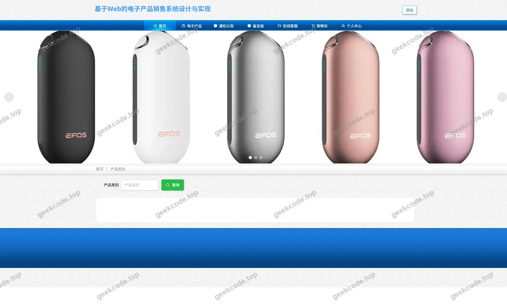</a>

<h4>前台-电子产品列表</h4>

<a href="https://geekcode.top/archives/%E5%9F%BA%E4%BA%8EWeb%E7%9A%84%E7%94%B5%E5%AD%90%E4%BA%A7%E5%93%81%E9%94%80%E5%94%AE%E7%B3%BB%E7%BB%9F%E8%AE%BE%E8%AE%A1%E4%B8%8E%E5%AE%9E%E7%8E%B0-%E8%AE%BA%E6%96%87?utm_source=github" title="查看完整源码">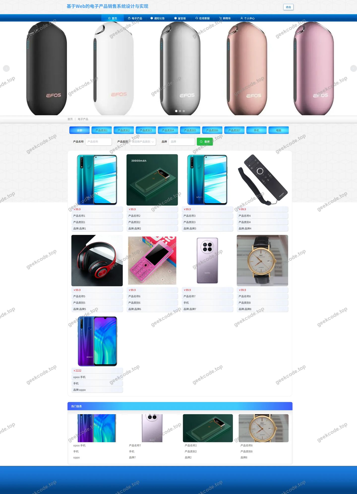</a>

<h4>前台-留言板列表</h4>

<a href="https://geekcode.top/archives/%E5%9F%BA%E4%BA%8EWeb%E7%9A%84%E7%94%B5%E5%AD%90%E4%BA%A7%E5%93%81%E9%94%80%E5%94%AE%E7%B3%BB%E7%BB%9F%E8%AE%BE%E8%AE%A1%E4%B8%8E%E5%AE%9E%E7%8E%B0-%E8%AE%BA%E6%96%87?utm_source=github" title="查看完整源码">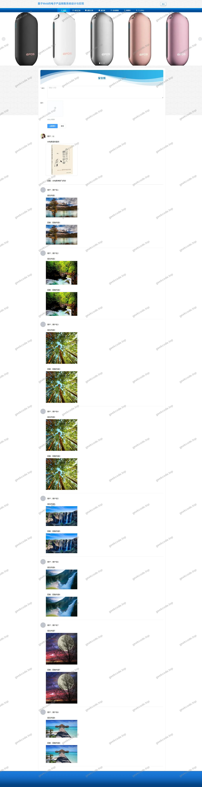</a>

<h4>前台-收藏列表</h4>

<a href="https://geekcode.top/archives/%E5%9F%BA%E4%BA%8EWeb%E7%9A%84%E7%94%B5%E5%AD%90%E4%BA%A7%E5%93%81%E9%94%80%E5%94%AE%E7%B3%BB%E7%BB%9F%E8%AE%BE%E8%AE%A1%E4%B8%8E%E5%AE%9E%E7%8E%B0-%E8%AE%BA%E6%96%87?utm_source=github" title="查看完整源码">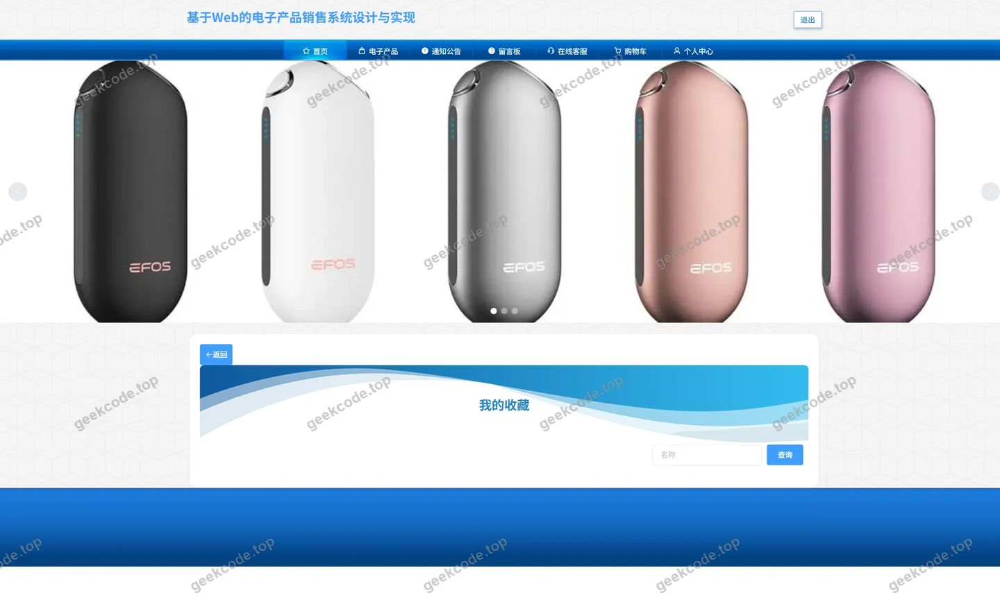</a>

<h4>前台-个人中心</h4>

<a href="https://geekcode.top/archives/%E5%9F%BA%E4%BA%8EWeb%E7%9A%84%E7%94%B5%E5%AD%90%E4%BA%A7%E5%93%81%E9%94%80%E5%94%AE%E7%B3%BB%E7%BB%9F%E8%AE%BE%E8%AE%A1%E4%B8%8E%E5%AE%9E%E7%8E%B0-%E8%AE%BA%E6%96%87?utm_source=github" title="查看完整源码">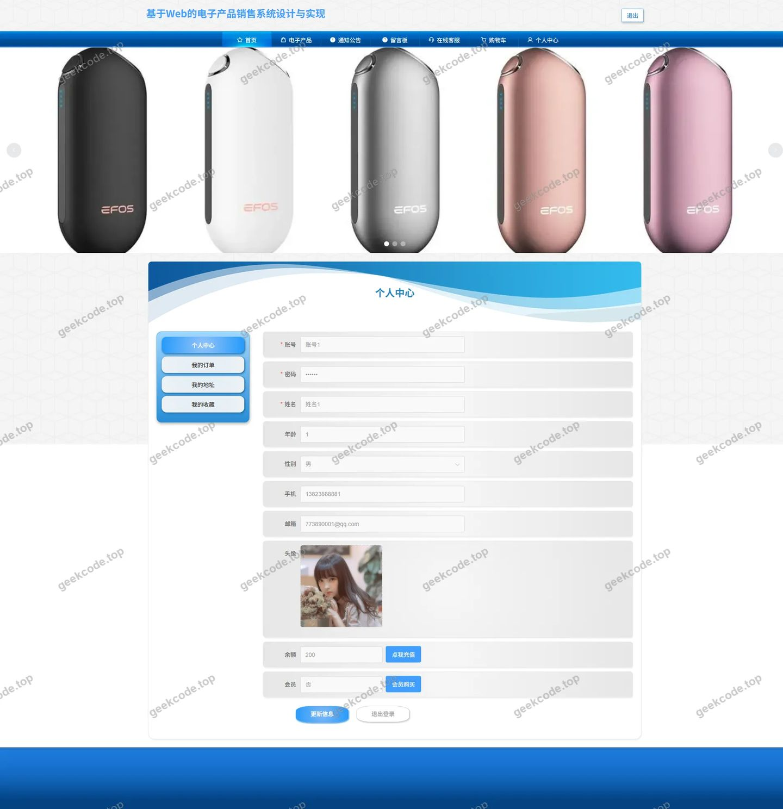</a>

<h4>前台-公告列表</h4>

<a href="https://geekcode.top/archives/%E5%9F%BA%E4%BA%8EWeb%E7%9A%84%E7%94%B5%E5%AD%90%E4%BA%A7%E5%93%81%E9%94%80%E5%94%AE%E7%B3%BB%E7%BB%9F%E8%AE%BE%E8%AE%A1%E4%B8%8E%E5%AE%9E%E7%8E%B0-%E8%AE%BA%E6%96%87?utm_source=github" title="查看完整源码">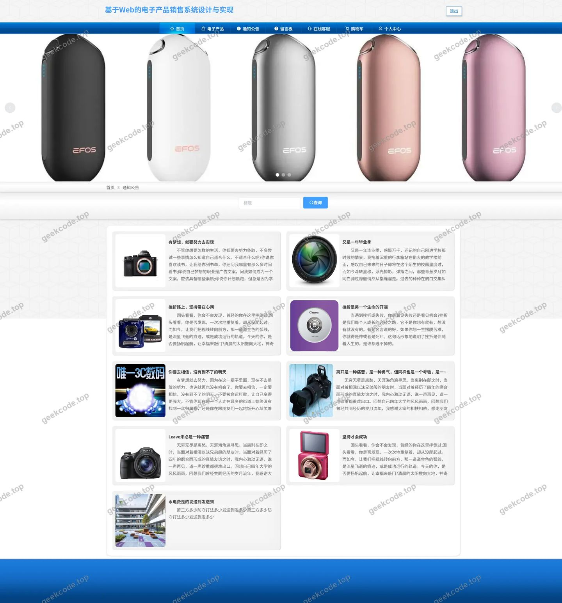</a>

<h3>后台管理端</h3>
<h4>后台-关于我们</h4>

<a href="https://geekcode.top/archives/%E5%9F%BA%E4%BA%8EWeb%E7%9A%84%E7%94%B5%E5%AD%90%E4%BA%A7%E5%93%81%E9%94%80%E5%94%AE%E7%B3%BB%E7%BB%9F%E8%AE%BE%E8%AE%A1%E4%B8%8E%E5%AE%9E%E7%8E%B0-%E8%AE%BA%E6%96%87?utm_source=github" title="查看完整源码">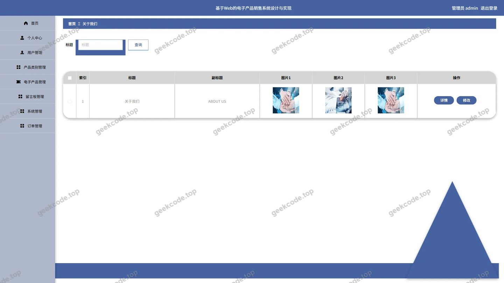</a>

<h4>后台-产品类别</h4>

<a href="https://geekcode.top/archives/%E5%9F%BA%E4%BA%8EWeb%E7%9A%84%E7%94%B5%E5%AD%90%E4%BA%A7%E5%93%81%E9%94%80%E5%94%AE%E7%B3%BB%E7%BB%9F%E8%AE%BE%E8%AE%A1%E4%B8%8E%E5%AE%9E%E7%8E%B0-%E8%AE%BA%E6%96%87?utm_source=github" title="查看完整源码">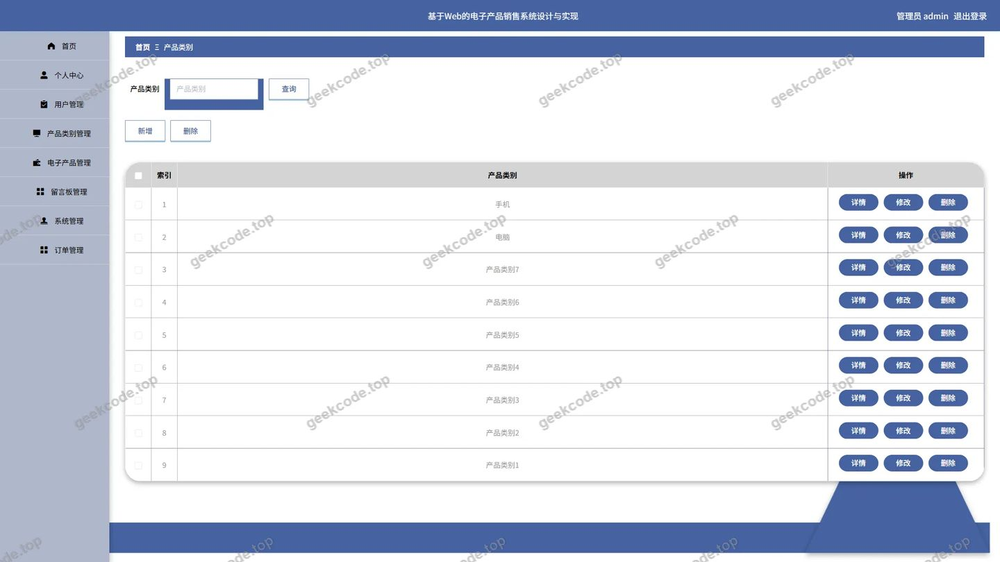</a>

<h4>后台-在线客服</h4>

<a href="https://geekcode.top/archives/%E5%9F%BA%E4%BA%8EWeb%E7%9A%84%E7%94%B5%E5%AD%90%E4%BA%A7%E5%93%81%E9%94%80%E5%94%AE%E7%B3%BB%E7%BB%9F%E8%AE%BE%E8%AE%A1%E4%B8%8E%E5%AE%9E%E7%8E%B0-%E8%AE%BA%E6%96%87?utm_source=github" title="查看完整源码">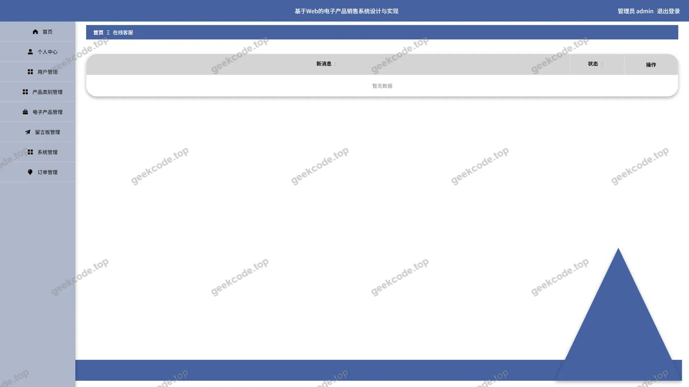</a>

<h4>后台-系统配置</h4>

<a href="https://geekcode.top/archives/%E5%9F%BA%E4%BA%8EWeb%E7%9A%84%E7%94%B5%E5%AD%90%E4%BA%A7%E5%93%81%E9%94%80%E5%94%AE%E7%B3%BB%E7%BB%9F%E8%AE%BE%E8%AE%A1%E4%B8%8E%E5%AE%9E%E7%8E%B0-%E8%AE%BA%E6%96%87?utm_source=github" title="查看完整源码">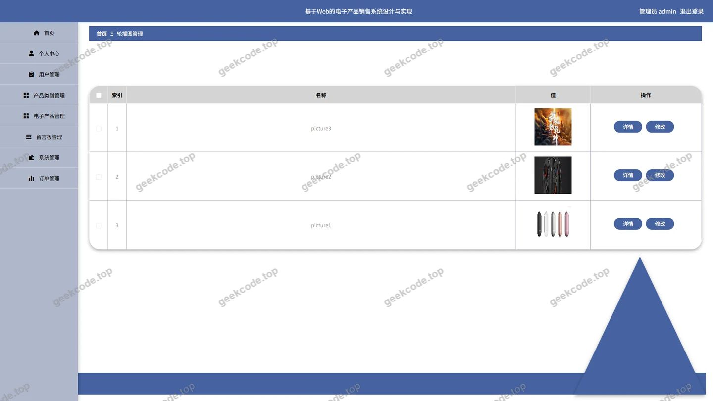</a>

<h4>后台-电子产品</h4>

<a href="https://geekcode.top/archives/%E5%9F%BA%E4%BA%8EWeb%E7%9A%84%E7%94%B5%E5%AD%90%E4%BA%A7%E5%93%81%E9%94%80%E5%94%AE%E7%B3%BB%E7%BB%9F%E8%AE%BE%E8%AE%A1%E4%B8%8E%E5%AE%9E%E7%8E%B0-%E8%AE%BA%E6%96%87?utm_source=github" title="查看完整源码">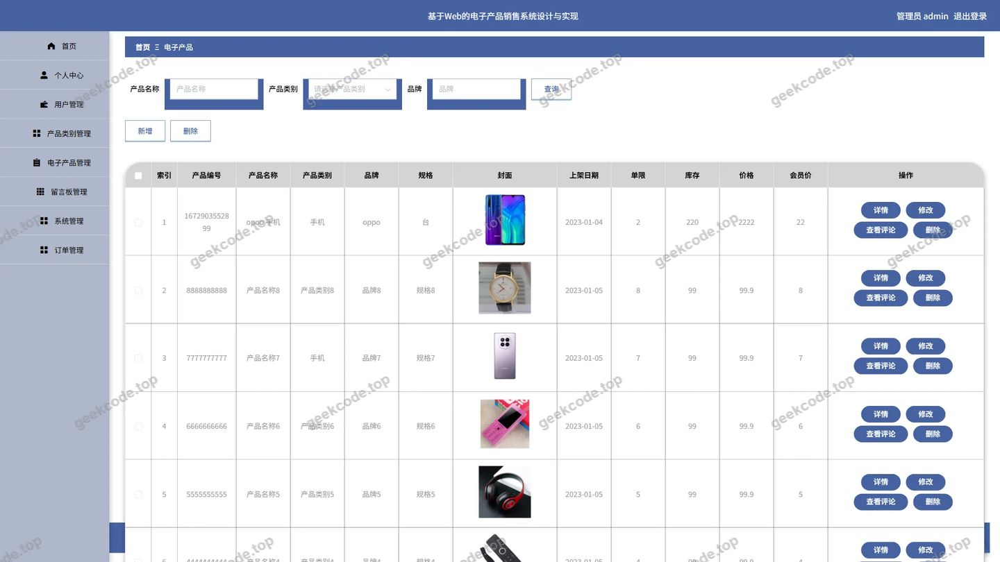</a>

<h4>后台-电子产品评论</h4>

<a href="https://geekcode.top/archives/%E5%9F%BA%E4%BA%8EWeb%E7%9A%84%E7%94%B5%E5%AD%90%E4%BA%A7%E5%93%81%E9%94%80%E5%94%AE%E7%B3%BB%E7%BB%9F%E8%AE%BE%E8%AE%A1%E4%B8%8E%E5%AE%9E%E7%8E%B0-%E8%AE%BA%E6%96%87?utm_source=github" title="查看完整源码">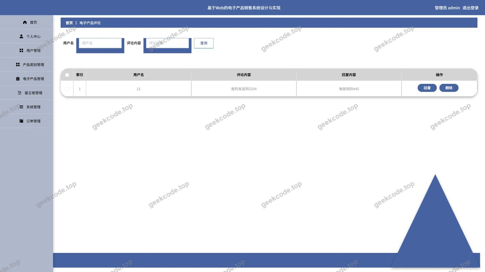</a>

<h4>后台首页</h4>

<a href="https://geekcode.top/archives/%E5%9F%BA%E4%BA%8EWeb%E7%9A%84%E7%94%B5%E5%AD%90%E4%BA%A7%E5%93%81%E9%94%80%E5%94%AE%E7%B3%BB%E7%BB%9F%E8%AE%BE%E8%AE%A1%E4%B8%8E%E5%AE%9E%E7%8E%B0-%E8%AE%BA%E6%96%87?utm_source=github" title="查看完整源码">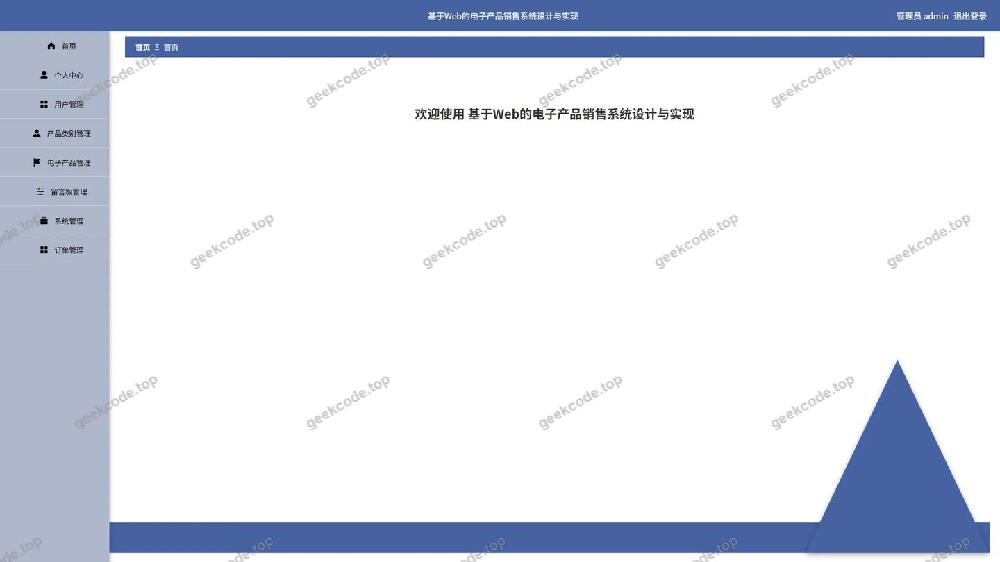</a>

<h4>后台-登录</h4>

<a href="https://geekcode.top/archives/%E5%9F%BA%E4%BA%8EWeb%E7%9A%84%E7%94%B5%E5%AD%90%E4%BA%A7%E5%93%81%E9%94%80%E5%94%AE%E7%B3%BB%E7%BB%9F%E8%AE%BE%E8%AE%A1%E4%B8%8E%E5%AE%9E%E7%8E%B0-%E8%AE%BA%E6%96%87?utm_source=github" title="查看完整源码">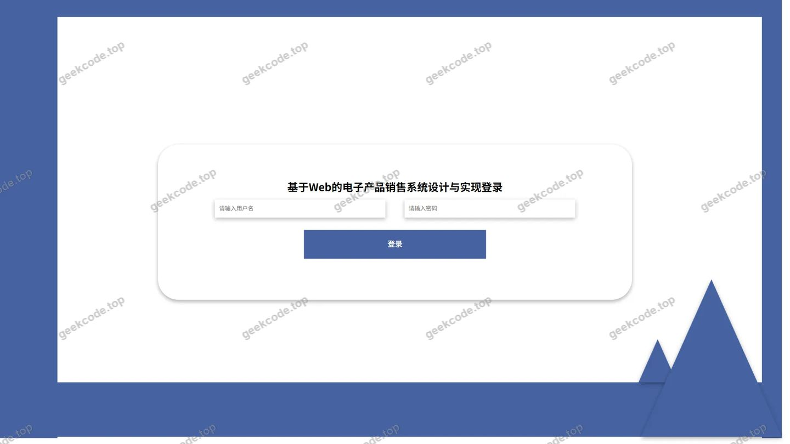</a>

<h4>后台-留言板</h4>

<a href="https://geekcode.top/archives/%E5%9F%BA%E4%BA%8EWeb%E7%9A%84%E7%94%B5%E5%AD%90%E4%BA%A7%E5%93%81%E9%94%80%E5%94%AE%E7%B3%BB%E7%BB%9F%E8%AE%BE%E8%AE%A1%E4%B8%8E%E5%AE%9E%E7%8E%B0-%E8%AE%BA%E6%96%87?utm_source=github" title="查看完整源码">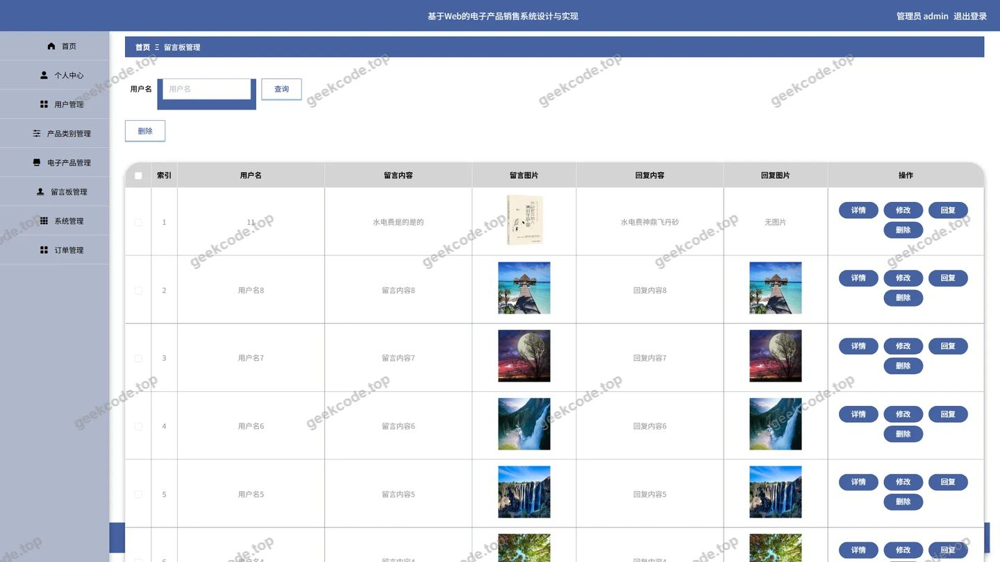</a>

<h4>后台-公告信息</h4>

<a href="https://geekcode.top/archives/%E5%9F%BA%E4%BA%8EWeb%E7%9A%84%E7%94%B5%E5%AD%90%E4%BA%A7%E5%93%81%E9%94%80%E5%94%AE%E7%B3%BB%E7%BB%9F%E8%AE%BE%E8%AE%A1%E4%B8%8E%E5%AE%9E%E7%8E%B0-%E8%AE%BA%E6%96%87?utm_source=github" title="查看完整源码">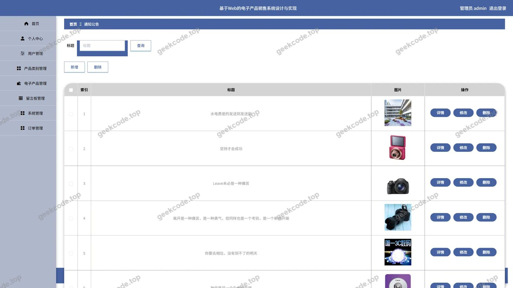</a>

<h4>后台-订单-状态</h4>

<a href="https://geekcode.top/archives/%E5%9F%BA%E4%BA%8EWeb%E7%9A%84%E7%94%B5%E5%AD%90%E4%BA%A7%E5%93%81%E9%94%80%E5%94%AE%E7%B3%BB%E7%BB%9F%E8%AE%BE%E8%AE%A1%E4%B8%8E%E5%AE%9E%E7%8E%B0-%E8%AE%BA%E6%96%87?utm_source=github" title="查看完整源码">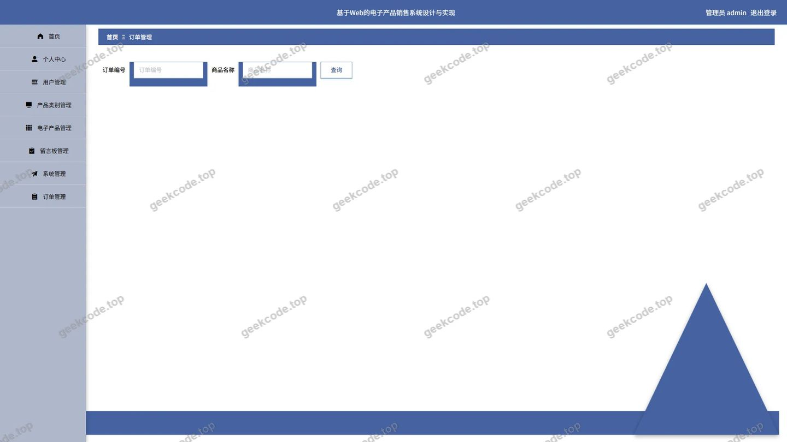</a>

---

## 获取完整源码

| 项目 | 说明 |
| --- | --- |
| 项目名 | 基于Web的电子产品销售系统设计与实现--论文 |
| 运行截图 | 本文 18 张（站点带水印原图，仓库 `images/` 目录） |
| 完整源码 | [https://geekcode.top/archives/%E5%9F%BA%E4%BA%8EWeb%E7%9A%84%E7%94%B5%E5%AD%90%E4%BA%A7%E5%93%81%E9%94%80%E5%94%AE%E7%B3%BB%E7%BB%9F%E8%AE%BE%E8%AE%A1%E4%B8%8E%E5%AE%9E%E7%8E%B0-%E8%AE%BA%E6%96%87?utm_source=github](https://geekcode.top/archives/%E5%9F%BA%E4%BA%8EWeb%E7%9A%84%E7%94%B5%E5%AD%90%E4%BA%A7%E5%93%81%E9%94%80%E5%94%AE%E7%B3%BB%E7%BB%9F%E8%AE%BE%E8%AE%A1%E4%B8%8E%E5%AE%9E%E7%8E%B0-%E8%AE%BA%E6%96%87?utm_source=github) |
| 咨询微信 | **ir9372**（备注：jingpin-yuanma） |
| 更多项目 | [极客代码 geekcode.top](https://geekcode.top/?utm_source=github) |

> 需要源码、部署、改配置、跑不起来等问题，加微信 ir9372 沟通，说明项目名即可。
